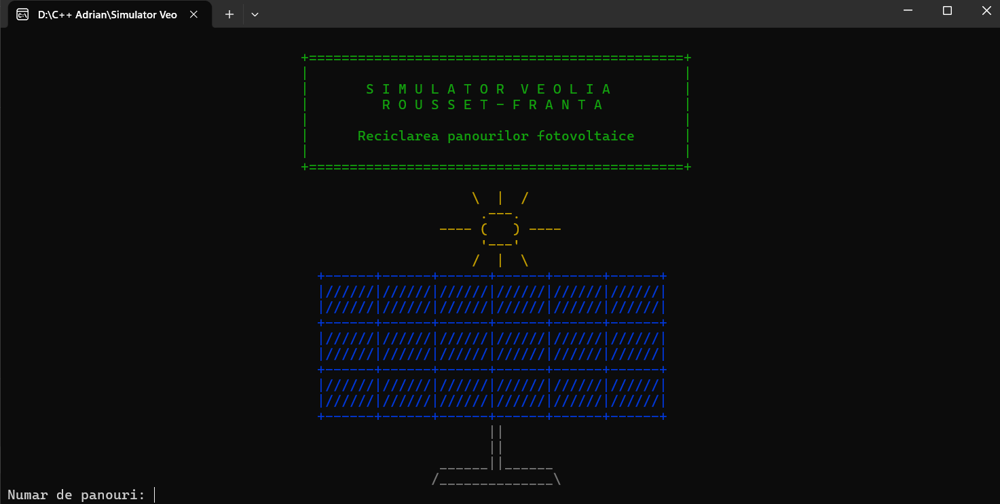
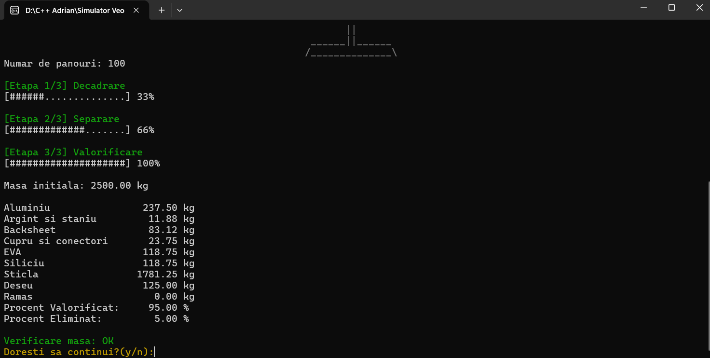

# SimVeolia IPMI ☀️♻️

Simulator în consolă (C++) pentru reciclarea panourilor fotovoltaice scoase din uz, realizat ca parte aplicată a proiectului **„Managementul Ecologic al Deșeurilor provenite din Panourile Fotovoltaice"**.

Programul este inspirat de **fabrica Veolia din Rousset** (regiunea Bouches-du-Rhône, Franța), studiul de caz al proiectului: primește un număr de panouri, le trece prin etapele de reciclare și afișează câte kilograme din fiecare material se recuperează și cât ajunge deșeu.

---

## Descărcare (Release)

Dacă vrei doar să rulezi programul, nu trebuie să compilezi nimic:

1. Deschide secțiunea **Releases** a acestui repository.
2. Descarcă fișierul **`SimEcoSolar.exe`** din ultima versiune.
3. Rulează-l dintr-un terminal (PowerShell sau terminalul din VS Code), ca să se vadă culorile și să rămână afișat rezultatul.

Executabilul este compilat pe Windows, cu bibliotecile incluse (`-static`), deci nu necesită MSYS2/MinGW instalat. Codul sursă rămâne în folderele `Source/` și `Headers/`.

---

## Studiul de caz: Veolia Rousset

| Indicator | Valoare |
|-----------|---------|
| Locație | Rousset, Bouches-du-Rhône, Franța |
| Lansare | martie 2017 |
| Inaugurare oficială | 5 iulie 2018 |
| Parteneriat | PV CYCLE France (în prezent SOREN) |
| Tip de panouri tratate | siliciu cristalin |
| Capacitate | ~1.800 t în primul an, până la 4.000 t/an |
| Investiție inițială | ~1.000.000 € |
| Rată de valorificare comunicată | ~95% |

Rata de ~95% este un indicator comunicat de Veolia și include atât reciclarea materială, cât și valorificarea energetică a unor fracții.

---

## Ce face programul

1. Citește numărul de panouri (cu validare: doar numere întregi pozitive).
2. Creează un **lot** cu masa totală = număr de panouri × masa medie a unui panou.
3. Rulează lotul prin cele 3 etape de reciclare.
4. Afișează materialele recuperate, deșeul rămas și verifică **conservarea masei** (nimic nu apare și nu dispare pe parcurs).
5. Afișează procentul valorificat și cel eliminat, apoi întreabă dacă vrei să continui (`y/n`).

### Etapele simulate

| # | Etapă | Ce se întâmplă |
|---|-------|----------------|
| 1 | **Decadrare** | Se îndepărtează rama de aluminiu (10% din masă) |
| 2 | **Separare** | Restul se împarte în sticlă, siliciu, EVA, backsheet, cupru, argint și staniu |
| 3 | **Valorificare** | Din fiecare material se recuperează o parte, restul devine deșeu |

La Rousset procesul real cuprinde îndepărtarea cadrului, demontarea componentelor electrice, mărunțirea și sortarea mecanică. În program, ultimele trei sunt grupate în etapa de separare.

---

## Date folosite

Compoziția unui panou (masă medie **25 kg**):

| Material | % din masă |
|----------|-----------|
| Sticlă securizată | 75 |
| Cadru de aluminiu | 10 |
| Celule de siliciu | 5 |
| EVA (encapsulant) | 5 |
| Backsheet | 3,5 |
| Cupru și conectori | 1 |
| Argint și staniu | 0,5 |

Rata de reciclare folosită este de **95%** pentru toate materialele, valoare apropiată de cea comunicată de Veolia pentru Rousset și aflată în intervalul 94–96% din sursa compoziției. Toate valorile se modifică într-un singur loc, în `Headers/date.h` și `Source/date.cpp`.

---

## Structura proiectului

```
Simulator/
├── .vscode/
│   ├── settings.json     # setări VS Code pentru proiect
│   └── tasks.json        # task de build (Ctrl+Shift+B)
├── Headers/
│   ├── arta.h            # banner, panou ASCII, bară de progres
│   ├── date.h            # constante, procente, rate de reciclare
│   ├── etape.h           # decadrare, separare, valorificare
│   ├── lot.h             # structura Lot (masă, materiale, deșeu)
│   └── utilitare.h       # citire validată, verificare masă, afișare
├── Source/
│   ├── arta.cpp
│   ├── date.cpp
│   ├── etape.cpp
│   ├── lot.cpp
│   ├── utilitare.cpp
│   ├── main.cpp          # leagă totul, în ordinea etapelor
│   └── build/
│       ├── Debug/        # executabilul de debug
│       └── Release/      # executabilul de release
├── images/               # capturi de ecran folosite în README
│   ├── start.png
│   └── rezultate.png
├── .gitignore
└── README.md
```

---

## Cum se compilează și se rulează

**Cerințe:** compilator `g++` cu suport C++17 sau mai nou (de exemplu MSYS2/MinGW-w64) pe Windows.

### Din VS Code

1. Deschide folderul proiectului.
2. Apasă **Ctrl+Shift+B** pentru build.
3. Rulează `Source\build\Debug\SimEcoSolar.exe` în terminal, sau apasă **F5** pentru debug.

### Din linia de comandă

Asigură-te că folderul `Source/build/Debug` există, apoi:

```
g++ -std=c++17 -Wall -Wextra -g -IHeaders Source/*.cpp -o Source/build/Debug/SimEcoSolar.exe
```

### Build pentru Release

Versiunea de release se compilează optimizat, fără informații de debug și cu bibliotecile incluse în executabil:

```
g++ -std=c++17 -O2 -DNDEBUG -IHeaders Source/*.cpp -static -o Source/build/Release/SimEcoSolar.exe
```

Fișierul `Source/build/Release/SimEcoSolar.exe` este cel încărcat în secțiunea Releases.

---

## Exemplu de rulare

### Ecranul de start

La pornire, programul afișează un banner și un panou solar desenat în ASCII, ambele centrate în fereastra terminalului, apoi cere numărul de panouri.



Elementele din captură:
- **banner verde** cu numele simulării (Veolia Rousset, Franța);
- **soarele** (galben), **panoul** (albastru) și **suportul** (gri), desenate din bucle și colorate cu coduri ANSI;
- promptul `Numar de panouri:`, care acceptă doar numere întregi pozitive.

### Rezultatele simulării

Pentru **100 de panouri** (2500 kg), programul trece lotul prin cele 3 etape, fiecare cu o bară de progres, apoi afișează rezultatul.



Ce se vede în captură:
- cele trei etape (**Decadrare**, **Separare**, **Valorificare**) cu bară de progres;
- masa inițială și cantitatea recuperată din fiecare material, în kg;
- **deșeul** (125 kg) și masa rămasă (0 kg), adică tot lotul a fost procesat;
- **Procent Valorificat: 95%** și **Procent Eliminat: 5%**;
- **Verificare masa: OK**, adică suma materialelor, deșeului și masei rămase este egală cu masa inițială;
- întrebarea `Doresti sa continui?(y/n)` de la final.

| Material | Recuperat (kg) |
|----------|---------------:|
| Aluminiu | 237,50 |
| Argint și staniu | 11,88 |
| Backsheet | 83,12 |
| Cupru și conectori | 23,75 |
| EVA | 118,75 |
| Siliciu | 118,75 |
| Sticlă | 1781,25 |
| **Deșeu** | **125,00** |
| Rămas | 0,00 |

Total recuperat: 2375 kg din 2500 kg (**95%**).

---

## Concepte de C++ folosite

- structuri cu constructor, funcții care modifică obiecte prin referință (`Lot&`)
- `std::map`, bucle `for` peste perechi cheie–valoare
- împărțirea codului în fișiere header (`.h`) și sursă (`.cpp`)
- `constexpr`, `const &`, inițializare cu acolade
- validarea input-ului cu `std::cin`, `clear()` și `ignore()`
- `std::chrono` și `std::thread` pentru pauze, coduri ANSI pentru culori
- raw string literals pentru arta ASCII

---

## Limitări

- Aceeași rată de reciclare se aplică tuturor materialelor; în realitate sticla și aluminiul se reciclează mai bine decât polimerii.
- Se simulează un singur tip de panou (siliciu cristalin).
- Nu sunt simulate capacitatea fabricii, costurile, veniturile sau transportul.
- Programul este o simulare simplificată, nu reproduce măsurători reale de la Rousset.
- Centrarea în fereastră folosește API-ul Windows (`windows.h`), iar pe alte sisteme se folosește o lățime implicită de 80 de coloane.

## Posibile extinderi

- partea financiară: prețuri pe tonă, cheltuieli, profit
- limitarea la capacitatea anuală a fabricii (4.000 t)
- simulare pe ani cu volume în creștere
- citirea parametrilor dintr-un fișier și salvarea raportului

---

## Autor

**Eremia Adrian** · TI - Ubc · 2026